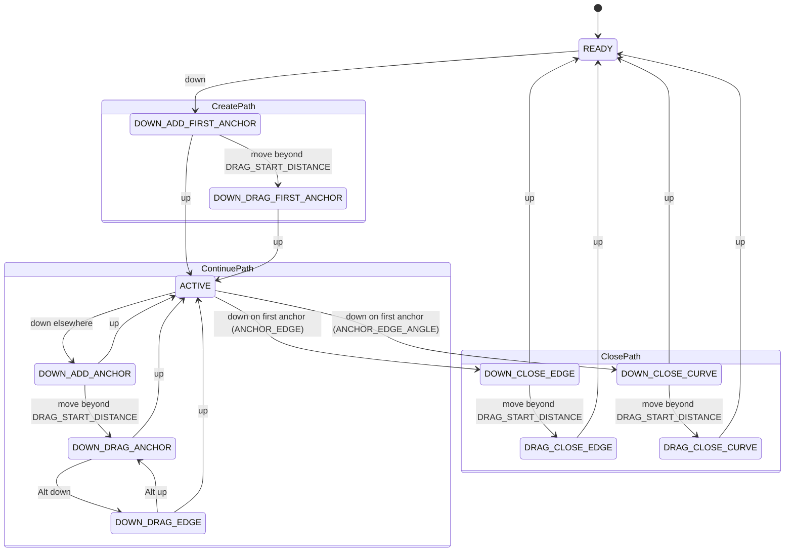

State diagram of the pen tool:

terminology:
* paths are [composite bézier curves](https://en.wikipedia.org/wiki/Composite_Bézier_curve)
* acceleration continuity:
* tangent continuity: 
* anchor point / knot / control point
* drag: pointer down, move, pointer up

create new path
* click: add anchor point without tangent
* drag: add anchor point with tangent

continue path (this should already draw a line)
* click: add anchor point without tangent
* drag: add anchor point with tangents
* opt/alt key: adjust forward tangents

special keys
* TODO esc / return: finish so a new path can be created
* TODO: backspace: remove last curve / line
* TODO shift: restrict to 45 degree angles
* TODO: tab: connect to another object
